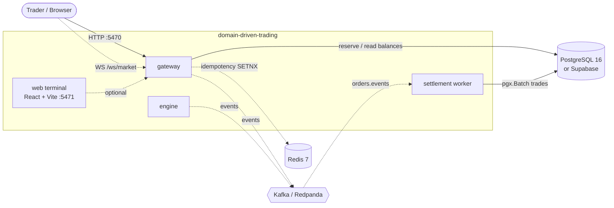
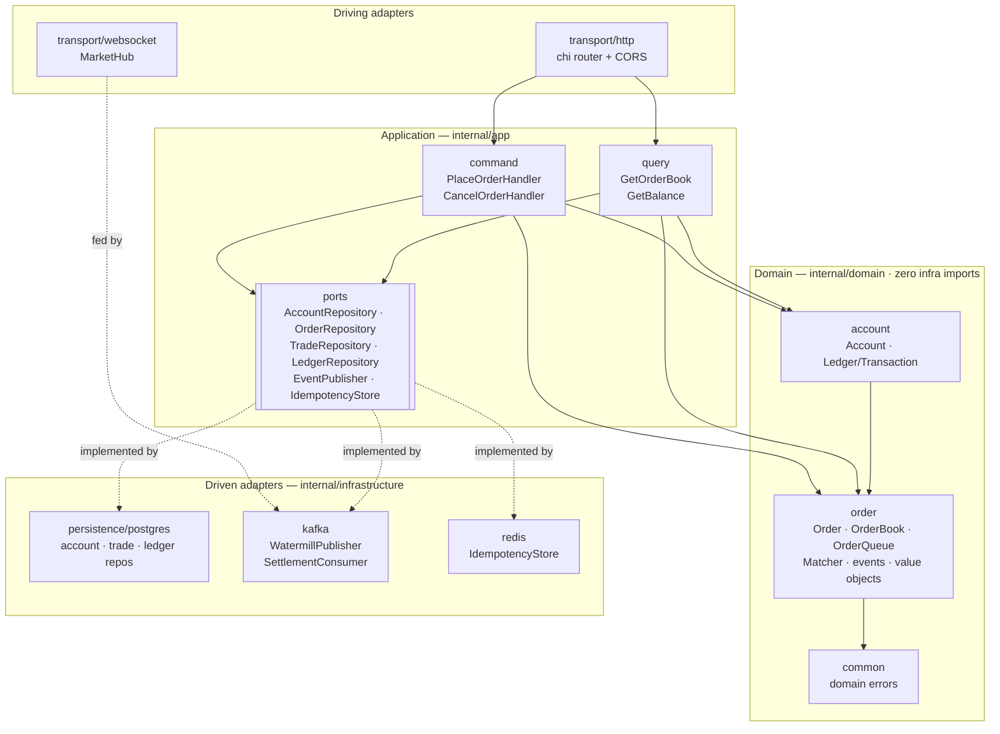
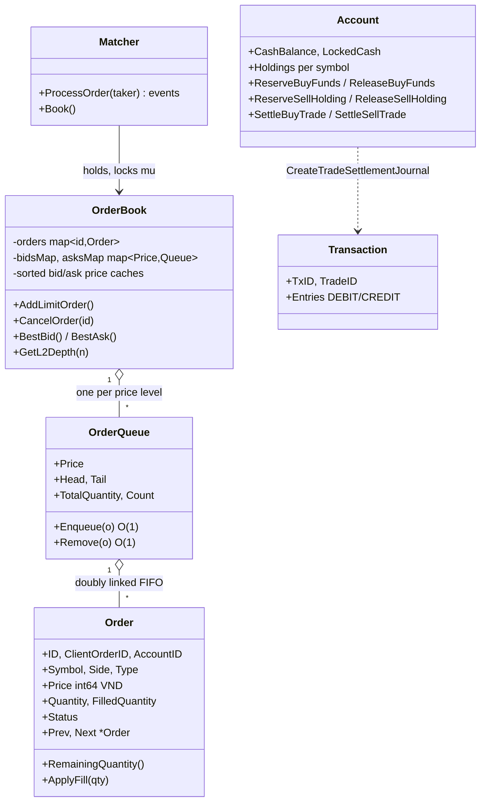
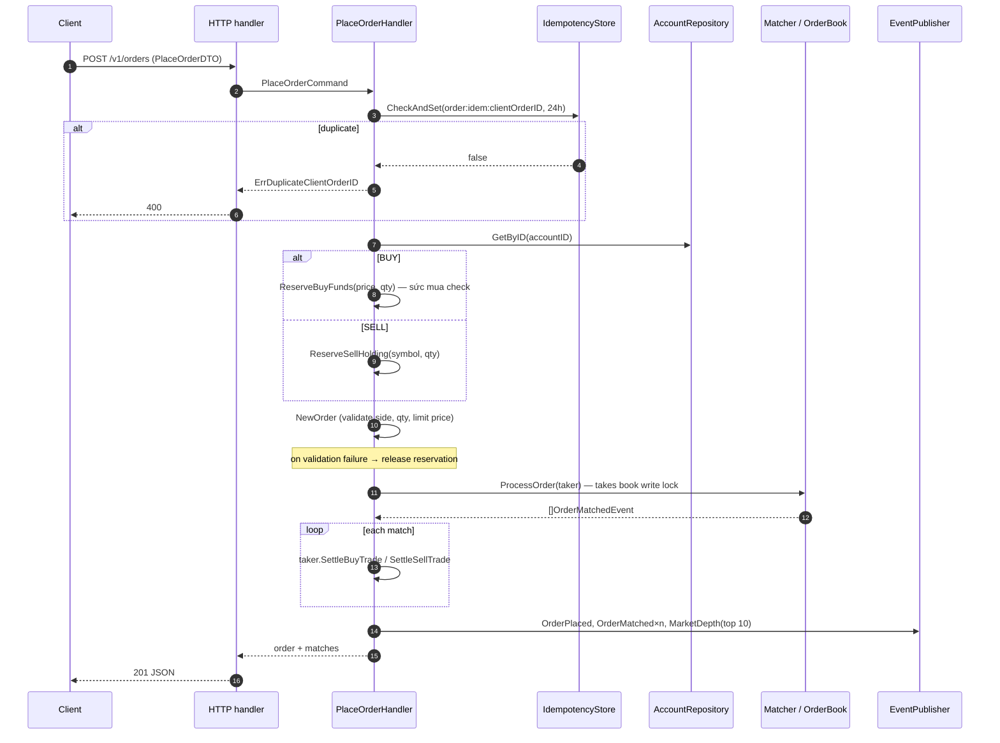
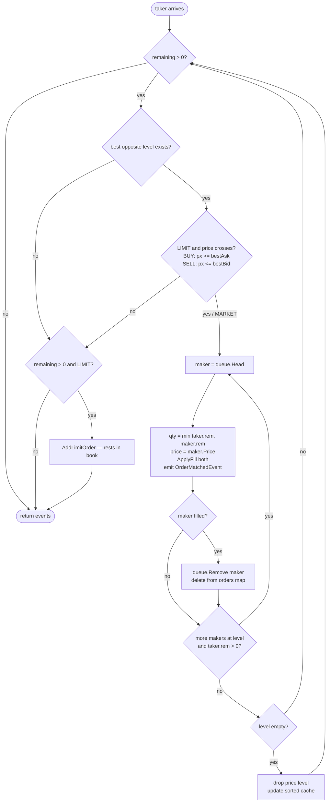
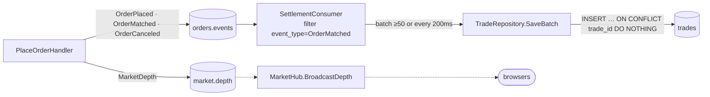
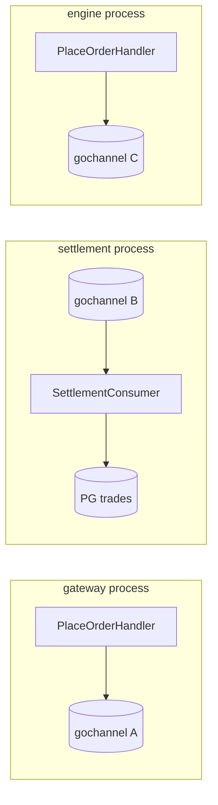
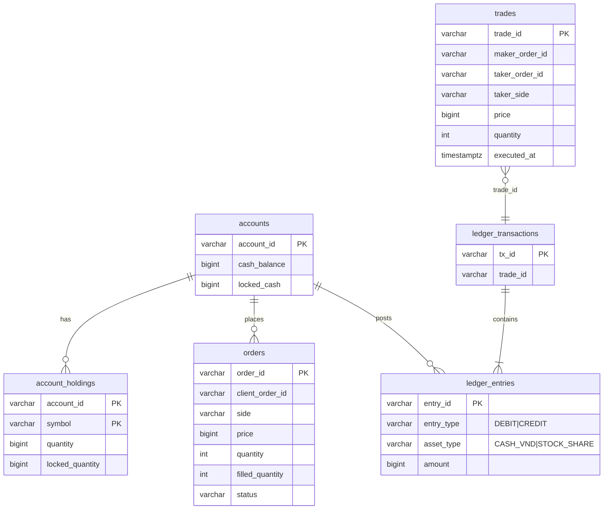
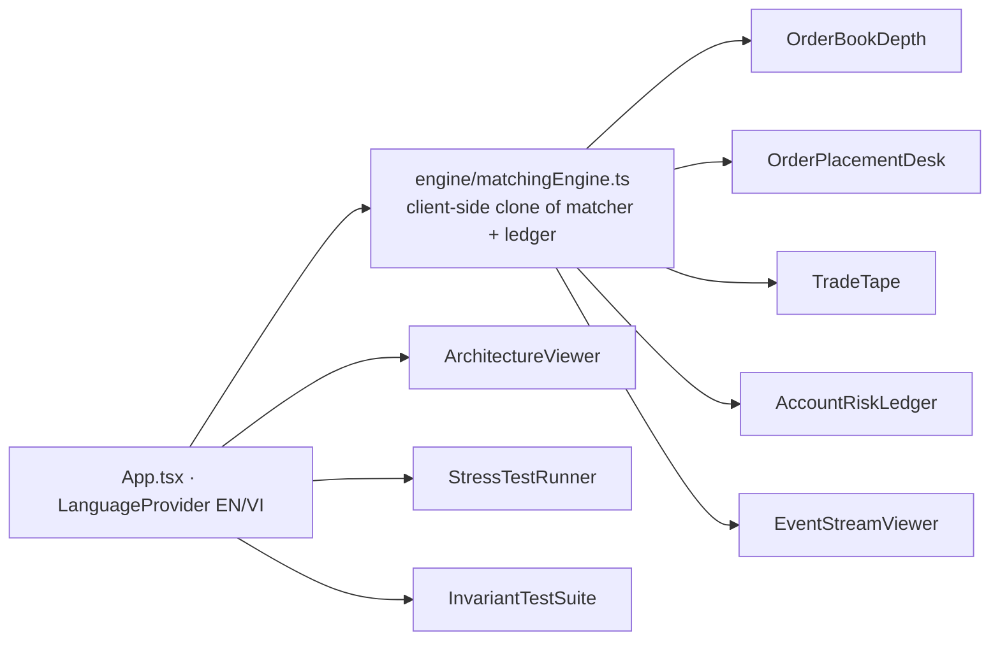
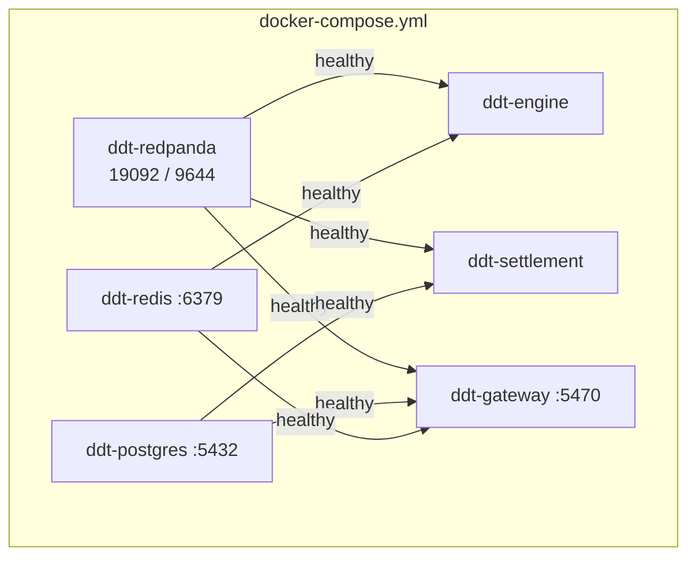

# domain-driven-trading — Architecture

Source: `C:\Git\JOBs\fin\domain-driven-trading` · Reviewed 2026-10-28

A PoC securities trading core in Go (DDD + Hexagonal + CQRS-lite): in-memory FIFO price-time order matching, pre-trade purchasing-power ("sức mua") reservation, double-entry ledger, and an event-driven settlement path (Watermill / Kafka-style). A React + Vite terminal sits on top.

> **Read this first — design vs. wiring.** The README describes the *target* architecture. The code that runs today is narrower. Every diagram below is marked **[wired]** (executes today) or **[designed]** (types/ports exist, but nothing connects them). Section 9 lists the gaps.

---

## 1. System context

Solid = wired in code. Dashed = designed/configured but not connected (see §9).

| Component | Entry | Role | Port |
|---|---|---|---|
| gateway | `cmd/gateway` | REST + WebSocket; owns its own matcher instance | 5470 |
| engine | `cmd/engine` | Standalone matcher, seeds 4 resting orders, then idles | — |
| settlement | `cmd/settlement` | Consumes `orders.events`, batch-inserts trades | — |
| web | `web/` | Trading terminal + educational viewers | 5471 |
| Redpanda / Postgres / Redis | `deployments/` | Broker, store, idempotency | 19092 / 5432 / 6379 |

---

## 2. Layered (hexagonal) view

Dependency rule: arrows point inward. `domain/` imports only the standard library and itself (`account` → `order` for `Price`/`Quantity`/`Symbol`). Ports live in `app/ports`, so infrastructure depends on the application, never the reverse.

---

## 3. Domain model

**Domain events** (`order/events.go`): `OrderPlacedEvent`, `OrderMatchedEvent` (trade), `OrderCanceledEvent`, `MarketDepthEvent` (L2 snapshot with `Sequence`).

**Key invariants**
- Prices are `int64` VND ticks — no floating point.
- One `OrderBook` per symbol; a single `sync.RWMutex` serialises `Matcher.ProcessOrder`.
- Maker sets the execution price; takers sweep best-price-first, FIFO within a level.
- Cancel is O(1) via the `orders` map plus linked-list unlink.
- Required funds = `price × qty × (1 + 15 bps)`; sell reserves share holdings instead.
- Ledger journal must satisfy `Σ debits = Σ credits` (buyer pays notional + fee, seller receives notional − fee, fee collector receives both fees).

**Order status:** `NEW → PARTIALLY_FILLED → FILLED`, or `NEW/PARTIAL → CANCELED`, `REJECTED` (proto only).

---

## 4. Pipeline — place order **[wired in gateway]**

Step notes
1. **Idempotency** is skipped when `ClientOrderID` is empty. Redis `SET NX EX 86400`; falls back to a process-local map.
2. **Risk before matching** — funds/shares are locked before the order can touch the book, so an overdraft cannot occur through this path.
3. **Matching** is synchronous and in-process; there is no inbound queue.
4. Only the **taker's** account is settled in `Handle`; the maker's reservation is not updated here (see §9).
5. Event publishing errors are discarded (`_ =`), so a broker failure never fails the order.

### Cancel
`DELETE /v1/orders/{id}?account_id=&symbol=` → `OrderBook.CancelOrder` (O(1) unlink) → release locked funds (`CalculateRequiredFunds` on remaining qty) or shares → publish `OrderCanceled` + `MarketDepth`.

### Queries (read side)
- `GET /v1/orderbook?symbol=APX&levels=10` → `GetOrderBookHandler` → `Book().GetL2Depth(n)`.
- `GET /v1/balance/{accountID}` → `GetBalanceHandler` → `AccountRepository.GetByID`.
- `GET /health`.

---

## 5. Matching algorithm

Unfilled **MARKET** remainder is discarded, not rested. Trade IDs: `TRD-<unixnano>-<atomic seq>`.

---

## 6. Event & settlement pipeline

### Designed topology

- Topics (`ports`): `orders.placement` (declared, unused), `orders.events`, `market.depth`.
- Message metadata: `event_type`, `partition_key = symbol`. Message UUID for matches = `TradeID`.
- Settlement flush is mutex-guarded; the trade insert is **idempotent** on `trade_id`, so redelivery is safe.
- `msg.Ack()` is called whether or not unmarshal/persist succeeded (at-most-once in effect).

### What actually runs today

Each binary calls `kafka.NewInMemoryPublisher()` and gets its **own** Go-channel bus. Nothing crosses a process boundary, so the settlement worker never receives a gateway trade.

---

## 7. Persistence

- `001_init.sql` — local Postgres schema + seed accounts (`ACC_APX_001`, `ACC_APX_002`, `ACC_INST_MM` 20B VND, `FEE_COLLECTOR`).
- `002_supabase_init.sql` — same tables with `CHECK (>= 0)` constraints and Supabase security hardening.
- Pool: pgx v5, `QueryExecModeSimpleProtocol` (required for PgBouncer transaction mode on Supabase :6543), 2–10 conns.
- **Account repository is write-through to an in-memory map**: reads hit memory first, then Postgres, then auto-create. `Save` upserts accounts only; holdings are not written back.
- `scripts/migrate_to_supabase.{go,py}` push the schema; `DIRECT_URL` is for DDL, `DATABASE_URL` (pooler) for runtime.

---

## 8. Frontend & deployment

### Web terminal (`web/`)

The UI drives a **deterministic in-browser engine** (`engineInstance`, ~700 lines) that re-implements matching, risk and ledger in TypeScript. It does not call the Go gateway — it is a simulator and teaching UI.

### Deployment (`deployments/`)

One multi-stage `Dockerfile` with targets `engine`, `settlement`, `gateway`. `docker-compose.services.yml` runs the services alone against external infra (hub Postgres/Redis, `host.docker.internal`). `.env.example` offers three DB modes: standalone compose, local hub Postgres, direct host.

Makefile: `dev`, `dev-services`, `build`, `test`, `test-race`, `benchmark` (k6, target >5k orders/s), `docker-up*`, `seed-db`, `migrate-supabase`, `run-engine|gateway|settlement|web`.

---

## 9. Gaps between design and code

Status updated 2026-10-28 after the phase-03 fix run (see `phase-03-review/updated-01.md`). Closed items are verified by tests named there; the original findings are kept for traceability.

| # | Gap | Status | Evidence / what remains |
|---|---|---|---|
| 1 | No real Kafka adapter | CLOSED | Watermill-Kafka chosen by `KAFKA_BROKERS` (`infrastructure/kafka/bus.go`); memory bus only with `BUS=memory`; live test against Redpanda passed. Only SASL/PLAIN (no SCRAM) |
| 2 | Redis client always `nil` | CLOSED | Real go-redis from `REDIS_ADDR`; no fallback; memory store only with `IDEMPOTENCY=memory`, bounded |
| 3 | WebSocket hub never fed | CLOSED | `websocket/feed.go`; crossing order reaches a client within 1 s (test + manual check); ids redacted |
| 4 | Ledger journal never posted | CLOSED | Trade + journal in one DB transaction (`SaveTradesWithJournal`); debits = credits verified on real Postgres |
| 5 | Orders never persisted | CLOSED (with caveat) | `OrderRepository`, recovery on start verified by restart test. Accounts, orders, trade+journal are three commits, so a crash between them can leave drift |
| 6 | Maker side not settled | CLOSED | Both sides settled, fees to `FEE_COLLECTOR`, conservation test |
| 7 | Two matchers, two books | PARTIAL | Shared `internal/bootstrap`; `cmd/engine` kept as deprecated in-memory wrapper, removal needs a decision |
| 8 | Silent error handling | CLOSED | Save/publish/lookup errors returned or logged; publisher retries with a non-durable dead-letter log |
| 9 | Ack regardless of outcome | CLOSED | Ack only after `SaveBatch`; poison to DLQ |
| 10 | Web ↔ backend decoupled | OPEN | Frontend still uses its own engine; it also needs to send the bearer token |
| 11 | Permissive edges | CLOSED | JWT/JWKS auth, account from claim, exact CORS and WS origin allowlists, rate limits. Needs a TLS terminator; `AUTH_MODE=disabled-for-local-dev` is loopback-only and opt-in |
| 12 | `.env` committed alongside `.env.example` | PARTIAL | `.env` is gitignored and not read by the bundle; the old DB password remains in git history: rotate (USER ACTION) |

### Suggested order to close the gaps
1. Real `message.Publisher/Subscriber` (Watermill Kafka) selected by `KAFKA_BROKERS`, keeping gochannel as the fallback — unblocks #1, #3, #7.
2. Wire `redis.NewClient` from `REDIS_ADDR` — #2.
3. Persist `Account` after reserve/settle, settle maker accounts on match — #6, #8.
4. Build the ledger journal per `OrderMatchedEvent` in the settlement worker and save it in the same transaction as the trade insert — #4.
5. Subscribe the gateway to `market.depth`/`orders.events` and call the hub broadcasts — #3.
6. Add an `OrderRepository` and replay/snapshot on engine start — #5.

---

## 10. Quick reference

| Concern | Where |
|---|---|
| Matching | `internal/domain/order/matcher.go`, `orderbook.go` |
| Pre-trade risk | `internal/domain/account/account.go` |
| Journal vouchers | `internal/domain/account/ledger.go` |
| Use cases | `internal/app/command`, `internal/app/query` |
| Ports | `internal/app/ports` |
| HTTP routes | `internal/infrastructure/transport/http/handler.go` |
| Settlement batching | `internal/infrastructure/kafka/consumer.go`, `persistence/postgres/trade_repository.go` |
| Wire formats | `proto/order.proto`, `proto/market.proto` (JSON is what's actually sent) |
| Tests | `domain/order/matcher_test.go`, `orderbook_test.go` (domain only) |
